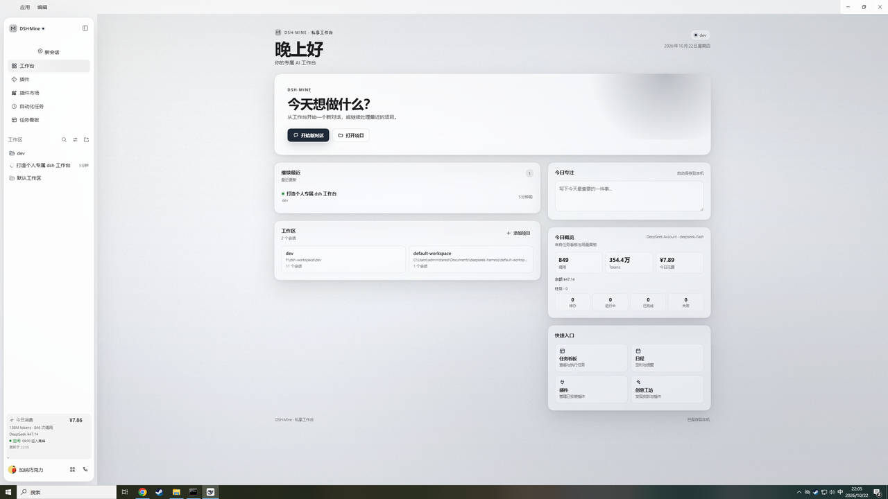
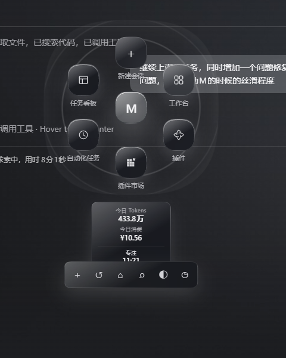

# DSH·Mine 私享工作台

一个面向 **macOS** 的 DeepSeek Harness（DSH）个人工作台 bundle。它把 DSH 的侧边栏、品牌区、首页驾驶舱、设置页和 Agent 预设收拢成一套黑白灰液态玻璃风格的工作台，并提供一个可拖动的 **M 轮盘**作为收起态入口。

> 这是一个可直接安装到其他 DSH 的 Cordis bundle，不是网页模板，也不需要单独构建前端。安装后由 DSH 的 Client Module Loader 加载 `client.js`。





## 特性

| 模块 | 能力 |
| --- | --- |
| 品牌 | 侧边栏品牌标记、品牌名、会话欢迎区标记；黑白灰液态玻璃 |
| 驾驶舱 | 问候语、继续最近会话、工作区、今日专注、今日概览、快捷入口 |
| 侧边栏 | macOS 玻璃卡片；展开态保留原生菜单；收起态只显示一个 **M** |
| M 轮盘 | 悬停 M 展开，移出轮盘/动作坞后收回；5 个面板 + 新建会话；图标下常显名称；可在窗口内自由拖动并记住位置 |
| 动作坞 | 新对话、最近会话、打开项目、命令搜索、主题切换、25 分钟专注 |
| 实时状态 | 任务看板未完成数量徽标；今日 Tokens / 今日消费；专注倒计时 |
| 命令搜索 | 搜索会话、工作区、侧边栏面板和动作，支持 ↑/↓/Enter/Esc |
| 设置 | 品牌名、副标题、今日专注文案、最近会话/使用量/任务统计开关、重置 |
| Agent 预设 | `DSH·Mine 私享`，中文优先，保留 DSH 标准工具集 |

## 环境要求

- DeepSeek Harness **0.2.1-rc.2 或更新版本**（Desktop 或 Web）。
- macOS 13+；Windows 也可用（当前开发环境为 Windows，macOS 使用同一套 Client API，建议在 Mac 上做一次视觉验收）。
- 不需要 Node.js、pnpm 或 npm 来安装本 bundle。

## 安装到另一台 DSH

### 1. 取得目录

```bash
git clone https://github.com/Dechuan0629/dsh-mine-workbench-cdc.git dsh-mine-workbench
```

如果目标机器没有 Git，也可以在 GitHub 页面选择 **Code → Download ZIP**，解压后得到 `dsh-mine-workbench` 目录。

### 2. 在 DSH 中安装

在 DSH 会话中让 Agent 执行：

```text
plugin_manager install_bundle target=/absolute/path/to/dsh-mine-workbench
```

`target` 必须是包含 `package.json` 的 **绝对目录**，不是 `package.json` 文件，也不是压缩包。安装器会读取 `dsh.bundle.patch` 和 `dsh.client`，把 bundle 写入当前 profile。

也可以在 DSH 的 **插件** 页面确认安装结果：应看到 `dsh-mine-workbench`，并处于启用状态。

### 3. 完全重启 DSH

安装或更新 Client bundle 后，**完全退出 DSH 再打开**，不要只刷新旧页面。旧页面的 boot graph 仍指向旧 revision，刷新可能得到 404；重启后 DSH 会用新的 boot graph 加载 `client.js`。

重启后：

- 左侧出现 `DSH·Mine` 品牌区；
- 点击右上角收起按钮，侧边栏收成一个 **M**；
- 悬停 **M** 展开轮盘；点击 M 展开完整侧边栏；
- 在 **设置 → DSH·Mine** 中调整偏好；
- 新建会话时选择预设 **DSH·Mine 私享**。

### 4. 卸载

```text
plugin_manager remove_bundle target=dsh-mine-workbench
```

然后完全重启 DSH。卸载不会自动删除浏览器 localStorage 中的偏好和轮盘位置。

## macOS 说明

- bundle 使用 `!!js process.platform` 选择 `tool-bash` 或 `tool-pwsh`：macOS 启用 Bash，禁用 PowerShell 工具。
- 所有路径都由 DSH 在运行时解析，没有写死 `C:\` 路径。
- Client 只使用标准 `[data-pane="sidebar"]`、`[data-sidebar-collapsed]` 和 `button[class*="toggle"]` 选择器，适配 macOS 的原生 sidebar 结构；macOS 的收起按钮位于顶部条，而 Windows 位于 logo 行，两处都由同一套选择器覆盖。
- 轮盘和偏好保存在当前浏览器：`localStorage` 键 `dshMineWorkbench.prefs.v1`、`dshMineWorkbench.wheelPos.v1`、`dshMineWorkbench.focus.v1`。
- 视觉使用 `backdrop-filter`、`color-mix()` 和容器查询；需要 macOS 13+ / 较新的 WebKit。若窗口透明效果异常，请先升级 DSH 和系统。

> 本仓库不包含额外的 skin 包。侧边栏、驾驶舱、轮盘和设置页的视觉都在 `client.js` 内，安装本 bundle 即可；不需要再安装 `dsh-mine-skin`。

## 数据与网络

- 运行时的同源请求只有两个可选接口：
  - `GET /api/dsh-usage/overview`：今日 Tokens / 消费；
  - `GET /api/task-board/state`：任务看板未完成数量。
- 两个请求都失败静默，不影响工作台使用。
- 不收集遥测，不上传偏好；偏好只写当前浏览器 localStorage。
- 会话和工作区数据来自 DSH 注入的 `useSessions` / `useWorkspaces`，本 bundle 不另建数据库。

## 目录结构

```text
dsh-mine-workbench/
├── client.js          # 全部 UI：品牌、驾驶舱、轮盘、搜索、设置、CSS
├── index.js           # Host 半侧（空 apply，仅用于 bundle 安装/清单）
├── cordis.patch.yml   # Host 行 + DSH·Mine 私享 Agent 预设
├── locale/
│   ├── zh.json
│   └── en.json
├── icon.svg
├── docs/              # README 截图
├── LICENSE
└── package.json
```

## 开发

`client.js` 是已经打包好的普通 JavaScript，不需要构建：

```bash
npm run check
```

`npm run check` 会对 `index.js` 和 `client.js` 执行 `node --check`。修改后重新安装 bundle 并完全重启 DSH，才能加载新的 Client 代码。

主要入口：

- `client.js` 顶部 `window.__ModuleLoader__.load({ id: 'dsh-mine-workbench', ... })`；
- `apply(ctx)` 注册 `sidebar.brand.mark`、`sidebar.brand.name`、`conversation.hero.brand.mark`、`sidebar.panellist`、`main`、`settings.section`；
- `installWheelSidebar(ctx, actions)` 实现收起态 M、hover 展开、拖动、动作坞、徽标、搜索和专注；
- `CommandPalette` / `commandBus` 实现全局命令搜索；
- `cordis.patch.yml` 的 `preset-mine-workbench` 定义 Agent 预设。

## 兼容性与已知边界

- 目前只在 DSH `0.2.1-rc.2` 上做过完整运行验证；DSH 升级后若 sidebar 的 data 属性或 slot 契约改变，可能需要同步调整。
- 轮盘使用原生面板按钮的 DOM 结构（不复制菜单逻辑），因此 DSH 的菜单项增减会自动反映。
- “最近会话”“打开项目”等动作依赖 DSH 的 `uiWorkspace` / `workspaces` 服务；服务缺失时按钮会静默降级。
- 任务看板徽标依赖已安装的任务看板插件及其 `/api/task-board/state` 接口；未安装时不显示徽标。
- 用量卡片依赖用量接口；接口不可用时显示“暂无数据”，不影响其他功能。

## License

MIT。见 [LICENSE](LICENSE)。
